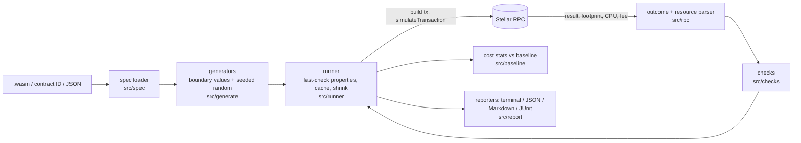

# soroban-testkit

[](https://github.com/nelly439/soroban-testkit/actions/workflows/ci.yml)
[](LICENSE)

**Spec-driven fuzzing, invariant checks and cost-regression testing for Soroban smart contracts, without writing test inputs by hand.**

Give soroban-testkit a contract (a `.wasm` file or a deployed contract ID). It reads the contract's interface, generates many valid and edge-case inputs for every function, and runs each one through Stellar RPC `simulateTransaction`. It reports:

- crashes (traps and panics) on inputs that match the declared types,
- non-deterministic results,
- accidental state writes from functions that should be read-only,
- violations of your own properties ("a balance is never negative"),
- CPU budget overruns, and cost regressions against a saved baseline, which can fail a CI build.

Every finding comes with a **shrunk, minimal counterexample**, the **seed** that found it, and a **replay file** that reproduces it exactly.

## Why

Contract developers usually test the inputs they think of. Bugs hide at the edges: zero, the maximum integer, empty vectors, odd addresses. Costs creep up between versions without anyone noticing. soroban-testkit generates those inputs automatically from the contract's own interface. Boundary values are always tried first, then seeded random values. It flags problems, and it can fail a CI build when a function gets more expensive.

## Who it is for

- Soroban contract authors who want a cheap extra safety net next to their Rust unit tests.
- Teams that want cost-regression gates in CI ("`transfer` must not get 10% more expensive").
- Auditors and reviewers who want a quick automated pass over a deployed contract's public interface.

## Features

- **Spec loading** from a `.wasm` (`contractspecv0` section), a deployed contract ID (over RPC), or a JSON spec file. `inspect` prints the interface.
- **Generators for every Soroban spec type**: bool, u32, i32, u64, i64, u128, i128, u256, i256, timepoint, duration, symbol, string, bytes, BytesN, address, Vec, Map, Option, Result, tuples, and user-defined structs, unions, enums and error enums. See [docs/generators.md](docs/generators.md).
- **Boundary values first** (0, 1, min, max, max-1, empty and single-element collections, all-zero / all-0xff addresses), then seeded random values.
- **Deterministic and reproducible**: every run prints its seed. `--seed` reproduces a run, `--replay <file>` re-runs one failure, and failing inputs are shrunk with [fast-check](https://fast-check.dev).
- **Six built-in checks**: `no-unexpected-trap`, `deterministic`, `read-only`, `budget`, `cost-regression`, `custom-property`. Each can be switched on or off per function. See [docs/checks.md](docs/checks.md).
- **Outcome classification**: success, declared contract error (allowed), trap/panic (a finding), and simulation/RPC failure. Simulation and RPC failures are reported separately and never counted as contract bugs.
- **Resource parsing**: CPU instructions, read/write footprint entries, read/write bytes and minimum resource fee.
- **Reporters**: terminal, JSON, Markdown and JUnit XML.
- **Meaningful exit codes**: `0` clean, `1` findings, `2` usage/config error, `3` RPC unreachable.
- **Library API**: everything the CLI does is a typed function. See [docs/api.md](docs/api.md).

## How it works



Nothing is ever signed or submitted: simulation does not change chain state. See [docs/concepts.md](docs/concepts.md) and [docs/architecture.md](docs/architecture.md).

## 5-minute quickstart

Requirements: Node.js 20 or newer, and git. No Rust and no network are needed: the repository ships two compiled example contracts in [`examples/wasm/`](examples/wasm) (a clean vault and one with six planted bugs, built from [`examples/rust-contracts/`](examples/rust-contracts)), plus a **fake** Stellar RPC used for tests and demos.

```sh
git clone https://github.com/nelly439/soroban-testkit.git
cd soroban-testkit
npm ci
npm run build

# 1. Read a contract's interface straight from the wasm
node dist/cli.js inspect examples/wasm/vault_buggy.wasm

# 2. Start the bundled fake RPC (a test tool: scripted contracts, not the real Soroban host)
npm run demo:rpc > demo-rpc.log 2>&1 &
sleep 3

# 3. Record a cost baseline from the clean contract
node dist/cli.js costs CBRWYZLBNYWXMYLVNR2AAAAAAAAAAAAAAAAAAAAAAAAAAAAAAAAAA4DZ \
  --config examples/vault-demo/soroban-testkit.config.json --update-baseline --seed 1

# 4. Fuzz the buggy contract: 6 findings, exit code 1
node dist/cli.js fuzz examples/wasm/vault_buggy.wasm \
  --contract-id CBRHKZ3HPEWXMYLVNR2AAAAAAAAAAAAAAAAAAAAAAAAAAAAAAAAABDL2 \
  --config examples/vault-demo/soroban-testkit.config.json --seed 1

# 5. Fuzz the clean contract: no findings, exit code 0
node dist/cli.js fuzz examples/wasm/vault_clean.wasm \
  --contract-id CBRWYZLBNYWXMYLVNR2AAAAAAAAAAAAAAAAAAAAAAAAAAAAAAAAAA4DZ \
  --config examples/vault-demo/soroban-testkit.config.json --seed 1

kill %1   # stop the fake RPC
```

Step 4 prints (abridged; full output in [docs/demo-output/fuzz-buggy.txt](docs/demo-output/fuzz-buggy.txt)):

```text
FINDINGS (6)

1) deterministic · roll
   two simulations of the same input gave different results
   first call:  returned 6912158355717386040
   second call: returned 6912158355717386091
   counterexample: salt=0  (minimal as found)
   seed: 1

2) no-unexpected-trap · first
   trapped with Error(WasmVm, InvalidAction)
   host: called `Option::unwrap()` on a `None` value
   counterexample: items=[]  (minimal as found)

3) no-unexpected-trap · div_by
   trapped with Error(WasmVm, InvalidAction)
   host: attempt to divide by zero
   counterexample: amount=0  (minimal as found)

4) read-only · balance
   function is configured read-only but writes 1 ledger entry: persistent contract data {"symbol":"LastSeen"}

5) custom-property · transfer · "balance after transfer is never negative"
   property "balance after transfer is never negative" failed: returned false (result: -1)
   counterexample: from="GAAA…AWHF", to="GAAA…AWHF", amount=1001  (shrunk in 121 steps)

6) cost-regression · compute
   cost grew beyond 10%: CPU max 1098200 -> 1537480 (+40%)
```

Once published to npm, use `npx soroban-testkit ...` instead of `node dist/cli.js ...`. Against a real network, point the tool at an RPC with `--network testnet`, `--rpc-url`, or `STELLAR_RPC_URL`. To fuzz a local `.wasm`, deploy it first and pass `--contract-id`; with a contract ID alone, the spec is downloaded from the chain.

## Using it in CI

```yaml
# .github/workflows/contract-tests.yml (excerpt; full example in docs/ci.md)
- run: npx soroban-testkit fuzz "$CONTRACT_ID" --network testnet --seed 12345 --junit reports/fuzz.xml
- run: npx soroban-testkit costs "$CONTRACT_ID" --network testnet --check-baseline --junit reports/costs.xml
```

`fuzz` exits `1` when it finds something and `costs --check-baseline` exits `1` when any function's CPU grows past the threshold, so either step fails the job. An unreachable RPC exits `3`, which you can treat as "infrastructure problem, retry" rather than "contract bug". See [docs/ci.md](docs/ci.md).

## How it compares

|                                                        | soroban-testkit                                                       | Soroban Rust unit tests (`soroban-sdk` testutils)           | Audits / formal tools  |
| ------------------------------------------------------ | --------------------------------------------------------------------- | ----------------------------------------------------------- | ---------------------- |
| Who writes the inputs                                  | generated from the spec                                               | you                                                         | experts / models       |
| Runs against                                           | an RPC's `simulateTransaction` (real host on a real or local network) | an in-process `Env`                                         | source code / bytecode |
| Multi-call stateful scenarios                          | **no** (each simulation starts from current chain state)              | yes                                                         | yes                    |
| Can inspect internal state, mock auth, advance ledgers | no                                                                    | yes                                                         | n/a                    |
| Finds edge-case crashes automatically                  | yes                                                                   | only for inputs you write (or with `proptest`/`cargo-fuzz`) | sometimes              |
| Cost regression gate in CI                             | yes (`costs --check-baseline`)                                        | possible with budget APIs, hand-written                     | no                     |
| Needs the contract source                              | no (wasm or contract ID)                                              | yes                                                         | usually                |

**What it does NOT do:**

- It does not replace Rust unit tests, integration tests, `cargo-fuzz`, or an audit. It is an extra, cheap layer.
- It cannot test sequences of calls whose state builds up: every simulation runs against current ledger state and nothing persists.
- It only sees what simulation reports. It cannot see internal variables, and it cannot prove properties for all inputs, only for the inputs it tried.
- The default test suite runs against a **fake RPC** with scripted contracts (see [docs/architecture.md](docs/architecture.md#testing-strategy-and-what-it-proves)). Real-network behaviour is covered by the optional `make integration`, which needs Docker.
- stellar-rpc 30 does not report memory usage in simulation responses, so **memory budgets and memory regressions only work with RPCs that still return the legacy `cost` field**.

## Documentation

|                                                |                                                                          |
| ---------------------------------------------- | ------------------------------------------------------------------------ |
| [Concepts](docs/concepts.md)                   | what simulation is, why it is safe, what each check can and cannot catch |
| [CLI reference](docs/cli.md)                   | every command, flag and exit code, with real output                      |
| [Configuration](docs/configuration.md)         | every option and environment variable                                    |
| [Checks](docs/checks.md)                       | how each built-in check works and how to tune it                         |
| [Custom properties](docs/custom-properties.md) | writing your own invariants, with three runnable examples                |
| [Generators](docs/generators.md)               | how each Soroban type maps to generated values                           |
| [CI](docs/ci.md)                               | GitHub Actions with baselines and JUnit                                  |
| [Library API](docs/api.md)                     | the TypeScript API                                                       |
| [Troubleshooting](docs/troubleshooting.md)     | common errors and fixes                                                  |
| [Architecture](docs/architecture.md)           | data flow, trade-offs, limitations                                       |

## Contributing

Contributions are welcome. This project takes part in the Stellar Wave program. Start with [CONTRIBUTING.md](CONTRIBUTING.md) (setup takes under 10 minutes), then pick an issue from [docs/WAVE_ISSUES.md](docs/WAVE_ISSUES.md). `make verify` runs everything CI runs.

## License

[MIT](LICENSE)
